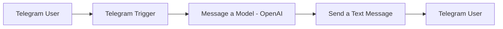

# 🤖 AI Telegram Chatbot — n8n & OpenAI

An AI-powered Telegram chatbot built using **n8n workflow automation** and **OpenAI's GPT models**. The bot receives messages from Telegram, processes them through an AI model, and automatically sends the generated response back to the user.

This project explores the integration of AI APIs with automation workflows to create a conversational chatbot without building a traditional backend from scratch.

---

## 📌 Overview

The chatbot connects Telegram with an AI language model through n8n. Whenever a user sends a message to the bot, the workflow is triggered automatically, forwards the message to the AI model, processes the response, and delivers it back to the user through Telegram.

The primary goal of this project is to understand how AI services, APIs, triggers, and workflow automation can be combined to build functional AI-powered applications.

## ✨ Features

- **AI-Powered Conversations** – Generates natural-language responses using an OpenAI model.
- **Telegram Integration** – Interacts with users directly through Telegram.
- **Automated Workflow** – Processes incoming messages without manual intervention.
- **Real-Time Message Processing** – Automatically triggers the workflow whenever a new message is received.
- **Lightweight AI Integration** – Uses a lightweight model to reduce API credit consumption.
- **No Traditional Backend Required** – The entire workflow is managed using n8n.
- **Modular Architecture** – Individual nodes can be modified or extended independently.
- **Scalable Foundation** – Can be extended with memory, tools, web search, voice processing, and additional automation capabilities.

---

## 🏗️ Workflow Architecture

The workflow consists of three primary nodes:



### 1. Telegram Trigger

**Purpose:** Detects and receives incoming messages from Telegram.

- Listens for incoming messages sent to the bot.
- Extracts message information from the Telegram update.
- Triggers the workflow whenever a new message arrives.
- Passes the incoming message data to the next node.

### 2. Message a Model — OpenAI

**Purpose:** Processes the user's message and generates an AI response.

- Receives the incoming message from the Telegram Trigger.
- Sends the message to the configured GPT model.
- Uses system instructions to define the chatbot's behavior.
- Generates a response based on the user's input.

The model can be changed depending on the balance between response quality, speed, and API cost.

### 3. Send a Text Message — Telegram

**Purpose:** Deliver the AI-generated response back to the user.

- Uses Telegram's messaging API through n8n.
- Sends the generated response to the user's Telegram chat.
- Completes the conversational cycle.

---

## 🔄 How It Works

The complete message-processing cycle follows these steps:

1. A user sends a message to the Telegram bot.
2. The Telegram Trigger detects the incoming message.
3. The message text is extracted from the incoming Telegram update.
4. The message is forwarded to the OpenAI model through n8n.
5. The AI model processes the input and generates a response.
6. n8n receives the generated response.
7. The Telegram Send Message node sends the response to the user.
8. The user receives the AI-generated reply on Telegram.

---

## 🛠️ Tech Stack

| Technology | Purpose |
|---|---|
| [Telegram Bot API](https://core.telegram.org/bots/api) | Messaging interface for user interaction |
| [n8n](https://n8n.io/) | Workflow automation and orchestration |
| [OpenAI API](https://platform.openai.com/) | AI response generation |
| GPT-5 Nano | Lightweight language model used for inference |
| APIs & Webhooks | Communication between services |

---

## 📋 Prerequisites

Before setting up the project, ensure you have:

- A Telegram account
- A Telegram bot created through [BotFather](https://t.me/BotFather)
- An n8n account or self-hosted n8n instance
- OpenAI API access or a compatible AI gateway
- API credits for model usage

---

## ⚙️ Setup & Installation

### Step 1 — Create a Telegram Bot

1. Open Telegram.
2. Search for **@BotFather**.
3. Start a conversation.
4. Execute the following command:

   ```text
   /newbot
   ```

5. Enter a name for your bot.
6. Enter a unique username ending in `bot`.
7. BotFather will generate an API token.
8. Save the token securely.

> ⚠️ Never share your Telegram Bot API token publicly or commit it to GitHub.

---

### Step 2 — Configure n8n

1. Open your n8n workspace.
2. Create a new workflow.
3. Add a **Telegram Trigger** node.
4. Connect your Telegram bot credentials using the API token generated by BotFather.
5. Set the trigger event to receive messages.
6. Test the trigger by sending a message to your Telegram bot.

---

### Step 3 — Integrate the AI Model

1. Add the **Message a Model** node to the workflow.
2. Connect the Telegram Trigger to the AI node.
3. Configure the AI model credentials.
4. Select the GPT model you want to use.
5. Configure the message input to dynamically receive the Telegram message.

Example input expression:

```javascript
{{ $('Telegram Trigger').item.json.message.text }}
```

### Suggested System Prompt

```text
You are a helpful AI assistant on Telegram.

Answer accurately, clearly, and naturally.
Keep answers concise unless the user asks for a detailed explanation.
Be friendly without being unnecessarily verbose.
If you do not know something, be honest rather than inventing information.
Adapt your response to the user's question and context.
```

The system prompt can be modified to give the bot a specific personality, role, or behavior.

---

### Step 4 — Configure the Telegram Response

1. Add the **Send a Text Message** node.
2. Connect it to the AI model node.
3. Select your Telegram credentials.
4. Configure the Chat ID to dynamically reference the incoming user's chat.

Example Chat ID expression:

```javascript
{{ $('Telegram Trigger').item.json.message.chat.id }}
```

Configure the message text to use the generated response from the AI model node.

> The exact response field may vary depending on the output format of the selected AI node. Use the node's output panel to identify the correct field.

---

### Step 5 — Connect the Workflow

Ensure that your nodes are connected in the following order:

```text
Telegram Trigger
       ↓
Message a Model
       ↓
Send a Text Message
```

Check the input and output of each node to verify that data is being passed correctly.

---

### Step 6 — Activate the Workflow

1. Save your workflow.
2. Publish or activate the workflow using the option available in your n8n workspace.
3. Ensure that the Telegram Trigger is listening for production events.
4. Open Telegram and send a message to your bot.
5. Verify that the workflow executes successfully and returns an AI-generated response.

When the workflow is active, it will automatically process incoming messages without needing to manually execute the workflow each time.

---

## 🧠 Model Configuration

The project uses **GPT-5 Nano**, a lightweight model selected to keep API usage economical while providing responses for everyday conversational tasks.

Model selection can be adjusted depending on the requirements.

| Requirement | Consideration |
|---|---|
| Lower API cost | Use a lightweight model |
| Faster responses | Prefer models optimized for low latency |
| Complex reasoning | Use a more capable model |
| Longer conversations | Requires additional context handling or memory |

Actual API costs depend on the model selected, the number of tokens processed, the input length, and the generated output length.

---

## 📂 Workflow Structure

```text
AI-Telegram-Chatbot/
│
├── README.md
│
└── workflow/
    └── telegram-ai-chatbot.json
```

> The `workflow/` directory is intended for the exported n8n workflow JSON file, if you choose to include it in the repository.

---

## 🔐 Security Considerations

- Never upload Telegram bot tokens to GitHub.
- Never commit OpenAI API keys or other credentials.
- Use n8n's credential manager to securely store API credentials.
- Avoid exposing API keys in workflow screenshots.
- If a token is accidentally exposed, revoke it immediately and generate a replacement.
- Review the workflow JSON before uploading it because exported workflows may contain sensitive configuration or other information.

---

## 🚧 Current Limitations

The current version is intentionally simple and focuses on the basic AI messaging pipeline.

- No persistent conversational memory is currently implemented.
- Each request may be processed independently unless conversation history is explicitly provided.
- The bot does not currently perform web searches.
- No voice-message transcription or audio response functionality.
- No custom tools or external actions are connected to the AI.
- Responses are limited by the capabilities and output limits of the selected model.
- Telegram message-length limitations may affect extremely long AI responses.

---

## 🚀 Future Enhancements

Potential improvements for future versions include:

- [ ] Persistent conversational memory
- [ ] User-specific context and preferences
- [ ] Web search integration for real-time information
- [ ] Voice message transcription
- [ ] AI-generated voice responses
- [ ] Custom AI personality and behavior
- [ ] Telegram commands such as `/help`, `/reset`, and `/about`
- [ ] Smart reminders and task automation
- [ ] Integration with external APIs
- [ ] AI-powered research capabilities
- [ ] Improved error handling and retry mechanisms
- [ ] Rate limiting and usage monitoring

---

## 🎯 Learning Objectives

This project helped explore and understand:

- Workflow automation using n8n
- Event-driven systems
- Telegram Bot API integration
- AI model integration through APIs
- Dynamic data mapping between workflow nodes
- Prompt engineering
- API-based application development
- Workflow debugging and execution monitoring
- Credential management

---

⭐ If you find this project interesting, consider exploring how workflow automation can be used to build more capable AI assistants.
